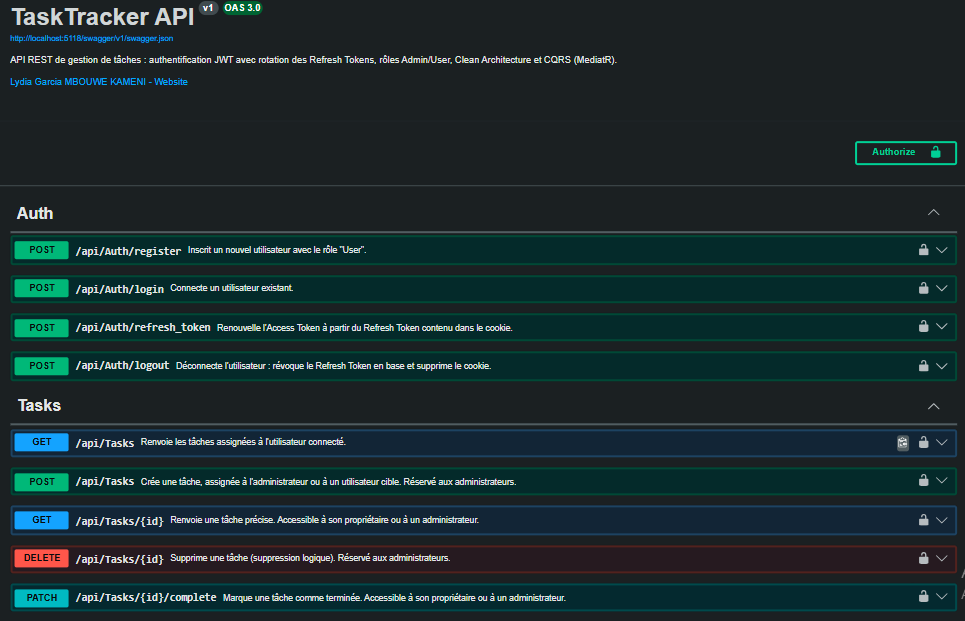

# TaskTracker API

[](https://github.com/lydiakameni/TaskTracker/actions/workflows/ci.yml)


🇬🇧 [English version](README.md)

API REST sécurisée de gestion de tâches, développée avec **ASP.NET Core (.NET 10)** selon les principes de la **Clean Architecture** et du **CQRS**.

Les administrateurs créent et assignent des tâches ; les utilisateurs consultent et terminent les tâches qui leur sont assignées.



---

## Fonctionnalités

- **Authentification JWT** avec des Access Tokens de courte durée (15 min)
- **Rotation des Refresh Tokens**, stockés dans un cookie `HttpOnly`, `Secure` et `SameSite=Strict`
- **Déconnexion avec révocation du token** en base de données
- **Autorisation par rôles** (`Admin` / `User`)
- **Règles de propriété** : un utilisateur n'accède qu'à ses propres tâches (un administrateur accède à toutes)
- **Validation des données** avec FluentValidation (robustesse du mot de passe, format du nom d'utilisateur, etc.)
- **Erreurs standardisées** selon la RFC 7807 (`ProblemDetails`), avec un `traceId`
- **Suppression logique** (soft delete) des tâches
- **Documentation interactive** avec Swagger / OpenAPI, générée à partir des commentaires XML

## Technologies

| Domaine | Technologie |
|---|---|
| Framework | ASP.NET Core 10, C# |
| Architecture | Clean Architecture, CQRS avec MediatR |
| Données | Entity Framework Core 10, SQL Server |
| Sécurité | JWT Bearer, BCrypt, rotation des Refresh Tokens |
| Validation | FluentValidation (pipeline behavior MediatR) |
| Tests | xUnit, Moq, WebApplicationFactory, EF Core InMemory |
| Intégration continue | GitHub Actions |

## Architecture

```
TaskTracker.Domain          Entités, interfaces des repositories, constantes (aucune dépendance)
TaskTracker.Application     Commandes, requêtes, handlers, validateurs, DTO, exceptions
TaskTracker.Infrastructure  EF Core, repositories, génération des JWT, hachage des mots de passe
TaskTracker.API             Contrôleurs, gestionnaire global des erreurs, Swagger
tests/
  TaskTracker.Application.Tests     Tests unitaires (handlers et validateurs)
  TaskTracker.API.IntegrationTests  Tests de bout en bout de l'API HTTP
```

Les dépendances pointent vers l'intérieur : le **Domain** ne connaît ni la base de données ni le web.
Les règles métier restent ainsi simples à tester et indépendantes des choix techniques.

## Choix de sécurité

- **Les mots de passe** sont hachés avec BCrypt et ne sont jamais stockés en clair.
- **La clé secrète JWT** n'est jamais versionnée : elle provient de `dotnet user-secrets` en développement
  et d'une variable d'environnement (`Jwt__SecretKey`) en production.
  L'API refuse de démarrer sans une clé valide (32 octets minimum).
- **Les Refresh Tokens** sont renouvelés à chaque utilisation : un token volé ne peut servir qu'une seule fois.
- **Le rôle** est attribué uniquement par le serveur : un nouveau compte reçoit toujours le rôle `User`.
- **Les tâches d'un autre utilisateur** renvoient `404 Not Found` (et non `403`), pour ne jamais révéler leur existence.
- **Les erreurs serveur** renvoient un message générique : aucun détail interne n'est exposé au client.

## Installation

### Prérequis

- [SDK .NET 10](https://dotnet.microsoft.com/download)
- SQL Server (Express ou LocalDB)
- Outil EF Core : `dotnet tool install --global dotnet-ef`

### 1. Cloner le dépôt

```bash
git clone https://github.com/lydiakameni/TaskTracker.git
cd TaskTracker
```

### 2. Configurer la clé secrète JWT

```bash
dotnet user-secrets set "Jwt:SecretKey" "<une-cle-aleatoire-d-au-moins-32-caracteres>" --project TaskTracker.API
```

Astuce : génère une clé sûre avec `openssl rand -base64 48`.

### 3. Créer la base de données

Adapte si besoin la chaîne de connexion dans `TaskTracker.API/appsettings.json`, puis lance :

```bash
dotnet ef database update --project TaskTracker.Infrastructure --startup-project TaskTracker.API
```

### 4. Lancer l'API

```bash
dotnet run --project TaskTracker.API
```

Ouvre Swagger à l'adresse `http://localhost:5118/swagger`.

### 5. Créer un administrateur

Un nouveau compte reçoit toujours le rôle `User`. Pour le promouvoir `Admin`, modifie-le directement en base :

```sql
UPDATE Users SET Role = 'Admin' WHERE Username = 'ton_nom_utilisateur';
```

Reconnecte-toi ensuite pour obtenir un token contenant le nouveau rôle.

## Routes de l'API

| Méthode | Route | Accès | Description |
|---|---|---|---|
| `POST` | `/api/auth/register` | Public | Créer un compte (rôle `User`) |
| `POST` | `/api/auth/login` | Public | Se connecter et recevoir les tokens |
| `POST` | `/api/auth/refresh_token` | Cookie de refresh | Obtenir un nouvel Access Token |
| `POST` | `/api/auth/logout` | Cookie de refresh | Se déconnecter et révoquer le Refresh Token |
| `GET` | `/api/tasks` | Connecté | Lister mes tâches |
| `GET` | `/api/tasks/{id}` | Propriétaire ou Admin | Consulter une tâche |
| `PATCH` | `/api/tasks/{id}/complete` | Propriétaire ou Admin | Marquer une tâche comme terminée |
| `POST` | `/api/tasks` | Admin | Créer et assigner une tâche |
| `DELETE` | `/api/tasks/{id}` | Admin | Supprimer une tâche (suppression logique) |

## Tests

```bash
dotnet test
```

- **Tests unitaires** : les handlers et les validateurs sont testés isolément, avec Moq pour simuler les dépendances.
- **Tests d'intégration** : l'API complète tourne en mémoire (`WebApplicationFactory`) avec une base en mémoire.
  Ils vérifient les vrais codes HTTP, l'authentification JWT, les rôles et les règles de propriété.

Les tests ne nécessitent ni SQL Server ni secret : c'est pour cela qu'ils s'exécutent aussi sur GitHub Actions.

## Autrice

**Lydia Garcia MBOUWE KAMENI**, développeuse backend C# / .NET

GitHub : [@LydiaKameni](https://github.com/LydiaKameni)
